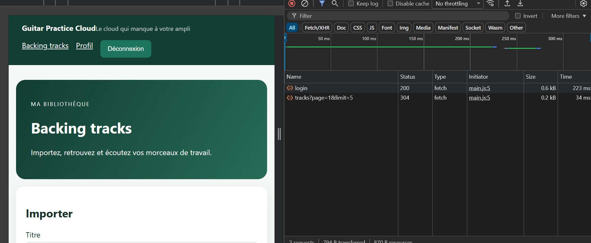
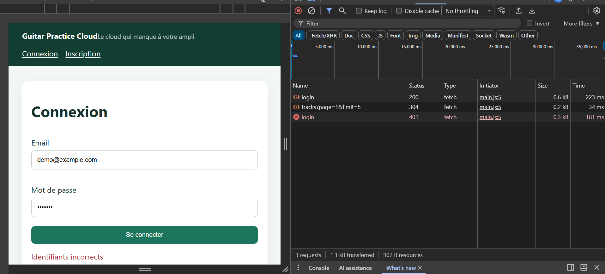
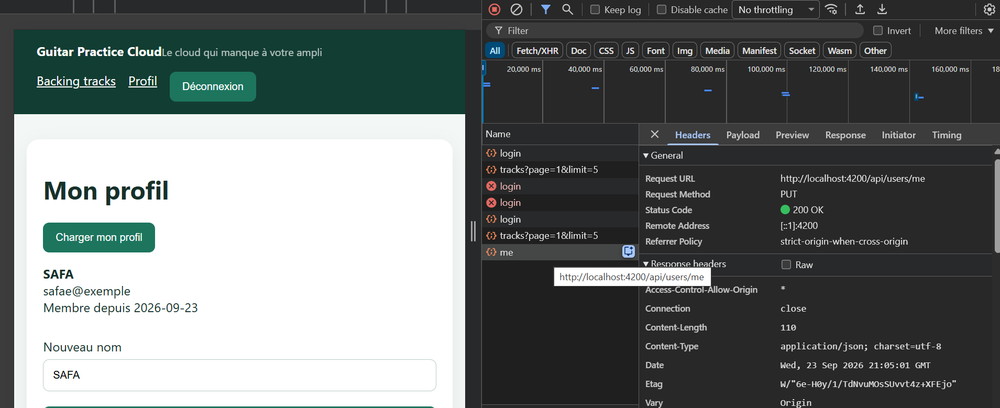

# Checkpoint — Preuves Network

TP1 — Architecture Authentification et Profil (Guitar Practice Cloud)

Captures réalisées dans DevTools → onglet Network → filtre Fetch/XHR, mots de passe et JWT jamais affichés en clair.

## 1. Connexion réussie

| Champ | Valeur |
|---|---|
| Méthode | POST |
| URL | `/api/auth/login` |
| Statut | **200** |
| Corps envoyé | `{ email, password }` (mot de passe non capturé) |
| Réponse | `{ token, user }` (token non capturé) |

## 2. Connexion refusée

| Champ | Valeur |
|---|---|
| Méthode | POST |
| URL | `/api/auth/login` |
| Statut | **401** |
| Corps envoyé | `{ email: "demo@example.com", password: "***" }` (mot de passe incorrect volontaire) |
| Réponse | `{ "message": "Identifiants incorrects" }` |
| Message affiché à l'écran | "Identifiants incorrects" (géré par le `Signal error` de `login-page.ts`) |

## 3. Modification de `/api/users/me`

| Champ | Valeur |
|---|---|
| Méthode | **PUT** |
| URL | `http://localhost:4200/api/users/me` (proxifié vers `http://localhost:3000/api/users/me`) |
| Statut | **200 OK** |
| Header `Authorization` | Présent (`Bearer <token>`, non affiché en entier dans la capture) |
| Réponse | Content-Type `application/json`, profil utilisateur mis à jour (nom modifié) |
| Contexte | Formulaire "Nouveau nom" sur `/profile`, soumis via `AuthService.update()` |

## Bilan

Les trois scénarios demandés par le Checkpoint sont couverts :
1. Authentification réussie → JWT émis et stocké
2. Authentification refusée → message d'erreur clair affiché à l'utilisateur, aucune fuite d'information sensible
3. Requête protégée (`PUT /api/users/me`) → header `Authorization` correctement transmis par l'interceptor, réponse `200` avec le profil mis à jour

Bonus observé au passage : la requête `GET /api/tracks?page=1&limit=5` apparaît aussi dans les captures avec un statut **304** (Not Modified — mise en cache HTTP), signe que le navigateur réutilise une réponse précédente quand rien n'a changé.
