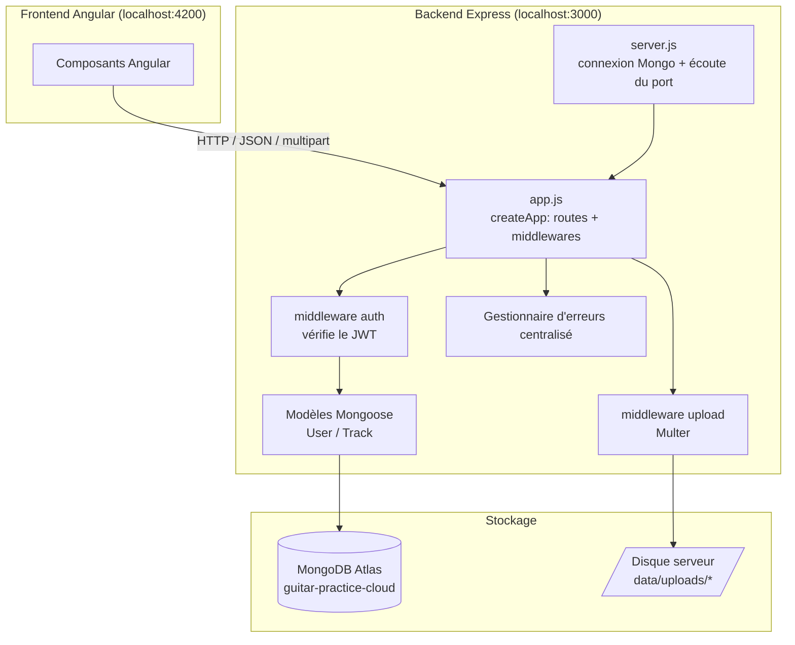
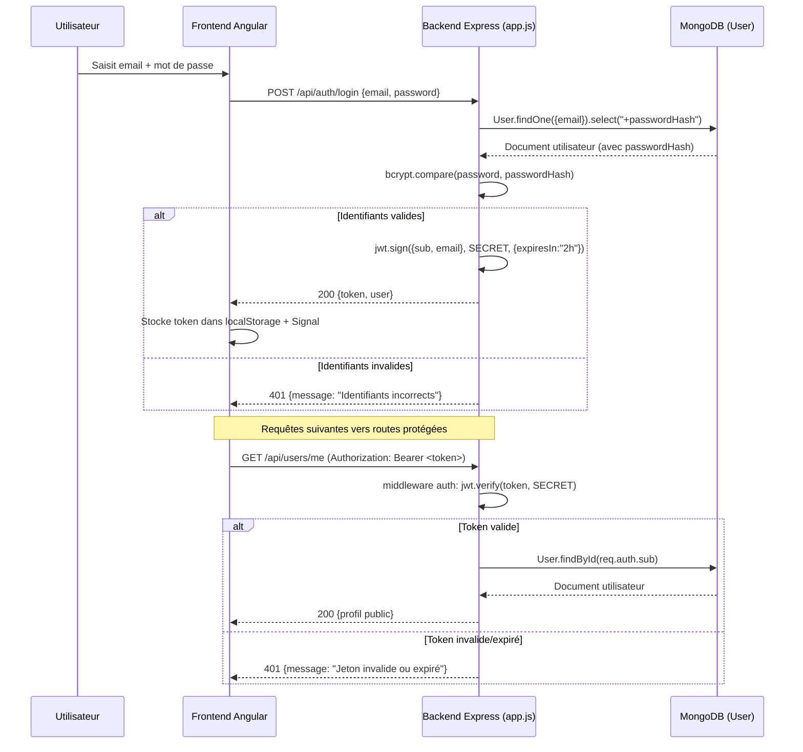
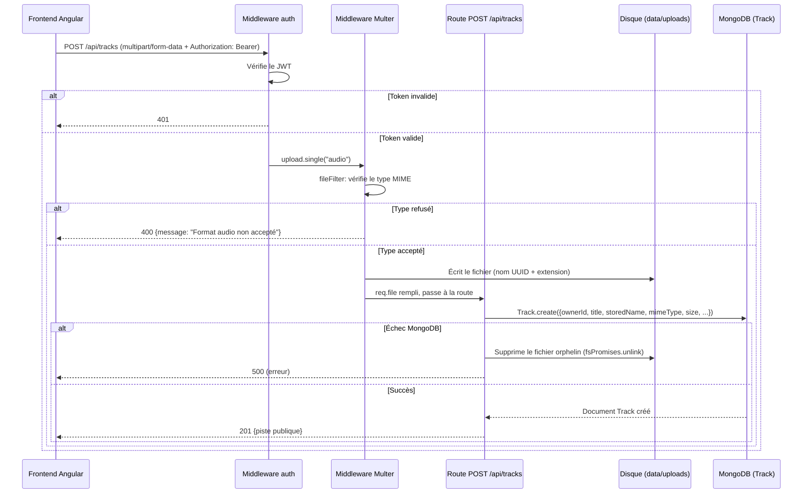
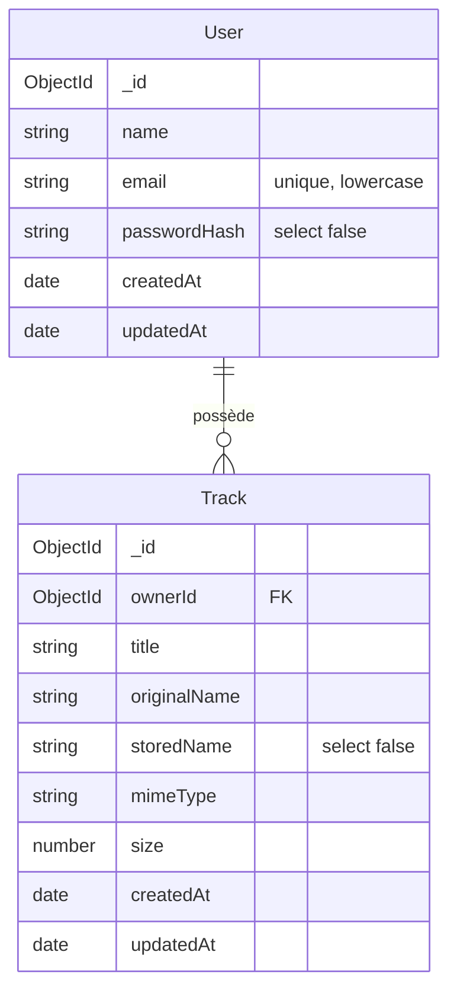
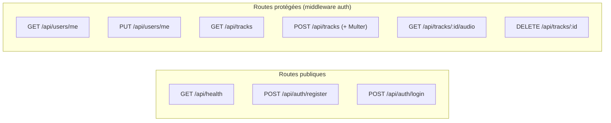

# Analyse du backend — Guitar Practice Cloud API

Backend Express/Mongoose fourni pour le TP1 (`gpc-api`, version 3.0.0). API REST servant de cloud personnel pour uploader, lister et écouter des fichiers audio, avec authentification par compte utilisateur.

## 1. Technologies et modules utilisés

| Module | Rôle |
|---|---|
| **express** (v5) | Framework web : routing, middlewares, gestion des requêtes/réponses |
| **mongoose** (v9) | ODM (Object-Document Mapper) pour MongoDB : schémas, validation, requêtes |
| **jsonwebtoken** | Génération et vérification des tokens JWT pour l'authentification |
| **bcryptjs** | Hachage sécurisé des mots de passe (jamais stockés en clair) |
| **multer** | Traitement des uploads `multipart/form-data`, écriture des fichiers sur disque |
| **cors** | Autorise les requêtes cross-origin depuis le frontend Angular (`localhost:4200`) |
| **node:fs / node:crypto / node:path** | Modules natifs Node.js pour la gestion du système de fichiers et la génération de noms aléatoires |

Le projet utilise les **modules ES** (`"type": "module"` dans `package.json`), donc `import`/`export` plutôt que `require`.

Deux points d'entrée :
- **`src/app.js`** : construit l'application Express (`createApp()`) sans ouvrir de port — permet de réutiliser la même app pour les tests automatisés (`test/api.test.js`) et pour le vrai serveur.
- **`src/server.js`** : connecte MongoDB, crée le compte de démonstration si absent, puis démarre l'écoute sur le port configuré.

## 2. Architecture générale

**Séparation des responsabilités :**
- `server.js` : cycle de vie du serveur (connexion DB, démarrage, arrêt)
- `app.js` : logique métier, routes, middlewares
- `models/*.js` : schémas de données, validation, méthodes liées aux documents
- Le fichier audio physique et sa métadonnée MongoDB sont **deux choses distinctes** : le fichier reste sur le disque (`data/uploads/`), MongoDB ne stocke que `storedName`, `originalName`, `mimeType`, `size`, etc.

## 3. Authentification

### 3.1 Mécanisme

- **Mot de passe** : jamais stocké en clair. Un champ virtuel Mongoose `password` (non persisté) déclenche un hook `pre('validate')` qui le hache avec **bcrypt** (10 rounds) dans `passwordHash`, marqué `select: false` (jamais renvoyé par défaut dans les requêtes).
- **Connexion** : `User.findOne({ email }).select("+passwordHash")` force explicitement la récupération du hash pour le comparer via `bcrypt.compare()`.
- **Token JWT** : signé avec un secret côté serveur (`JWT_SECRET`, jamais transmis au frontend), contient `sub` (id Mongo de l'utilisateur) et `email`, expire après **2 heures**.
- **Middleware `auth`** : lit l'en-tête `Authorization: Bearer <token>`, vérifie la signature et l'expiration via `jwt.verify()`, puis attache le payload décodé à `req.auth` pour les routes protégées.

### 3.2 Schéma du flux d'authentification

### 3.3 Routes d'authentification

| Route | Méthode | Protection | Rôle |
|---|---|---|---|
| `/api/auth/register` | POST | publique | Crée un compte (validation : nom, email, mot de passe ≥ 8 caractères, email unique) |
| `/api/auth/login` | POST | publique | Vérifie les identifiants, renvoie un JWT |
| `/api/users/me` | GET | protégée | Renvoie le profil public de l'utilisateur connecté |
| `/api/users/me` | PUT | protégée | Modifie le nom de l'utilisateur connecté |

## 4. Gestion de l'upload de fichiers

### 4.1 Principe

Le fichier audio et sa métadonnée suivent **deux chemins différents** :
- Le **contenu binaire** est écrit directement sur le disque du serveur par **Multer** (`diskStorage`), dans `data/uploads/`, sous un nom **aléatoire** (`crypto.randomUUID() + extension`) pour éviter toute collision entre utilisateurs.
- La **métadonnée** (titre, nom original, nom stocké, type MIME, taille, propriétaire) est enregistrée dans MongoDB via le modèle `Track`.

### 4.2 Contraintes appliquées par Multer

- **Taille maximale** : 25 Mo (`limits.fileSize`)
- **Types MIME autorisés** : `audio/mpeg`, `audio/wav`, `audio/x-wav`, `audio/ogg`, `audio/mp4`, `audio/x-m4a` — tout autre type est rejeté par `fileFilter` avant écriture sur le disque
- Un fichier refusé ne consomme jamais d'espace disque (le filtre agit **avant** l'écriture)

### 4.3 Schéma du flux d'upload

### 4.4 Téléchargement et suppression

- **`GET /api/tracks/:id/audio`** : vérifie que la piste appartient bien à l'utilisateur connecté (`ownerId: req.auth.sub`) avant de streamer le fichier via `res.sendFile()`. Empêche qu'un utilisateur accède aux fichiers d'un autre.
- **`DELETE /api/tracks/:id`** : supprime d'abord le document MongoDB (`findOneAndDelete`), puis le fichier physique correspondant. Si la suppression du fichier échoue, une erreur `500` explicite est renvoyée pour signaler un fichier orphelin à surveiller.

## 5. Échanges avec la base de données (MongoDB / Mongoose)

### 5.1 Connexion

`server.js` établit la connexion via `mongoose.connect(uri)` **avant** de démarrer le serveur HTTP — le serveur ne s'ouvre pas si la base est inaccessible (fail-fast). Un compte de démonstration (`demo@example.com`) est créé automatiquement au démarrage s'il n'existe pas encore.

### 5.2 Modèles (schémas Mongoose)

**Particularités notables :**
- `passwordHash` (User) et `storedName` (Track) ont `select: false` : ils ne sont **jamais** renvoyés par une requête standard, il faut explicitement les demander avec `.select("+champ")` — c'est une protection contre les fuites accidentelles de données sensibles.
- Chaque modèle expose une méthode `toPublic()` qui construit l'objet **sûr** à renvoyer au frontend (jamais le document Mongoose brut).
- Un index composé `{ ownerId: 1, createdAt: -1 }` sur `Track` accélère la pagination des pistes d'un utilisateur, triées par date décroissante.

### 5.3 Types de requêtes utilisées

| Opération | Méthode Mongoose | Contexte |
|---|---|---|
| Créer | `User.create()`, `Track.create()` | inscription, upload |
| Lire un seul document | `findOne()`, `findById()` | login, profil, vérif. propriété d'une piste |
| Lire plusieurs + compter | `find().sort().skip().limit()` + `countDocuments()` en parallèle (`Promise.all`) | pagination des pistes (`GET /api/tracks`) |
| Vérifier l'existence | `exists()` | email déjà utilisé, compte démo déjà créé |
| Modifier | `findByIdAndUpdate()` | mise à jour du nom |
| Supprimer | `findOneAndDelete()` | suppression d'une piste |

## 6. Gestion des erreurs

Un middleware d'erreur central (placé en dernier dans `app.js`) intercepte toutes les erreurs transmises via `next(error)` :

| Type d'erreur | Statut renvoyé |
|---|---|
| `MulterError` ou format audio refusé | 400 |
| `ValidationError` (Mongoose) | 400 |
| `CastError` (ex : id MongoDB malformé) | 404 |

Chaque route utilise `try/catch` et transmet les erreurs inattendues à `next(error)`, plutôt que de laisser le processus planter.

## 7. Vue d'ensemble des routes

## 8. Points de sécurité observés

- Mot de passe haché (bcrypt), jamais loggé ni renvoyé
- `JWT_SECRET` lu depuis l'environnement, jamais exposé au frontend
- Champs sensibles (`passwordHash`, `storedName`) exclus par défaut des requêtes Mongoose
- Vérification systématique de la **propriété** d'une ressource (`ownerId: req.auth.sub`) avant lecture/suppression d'une piste — empêche l'accès aux données d'un autre utilisateur
- Filtrage strict des types MIME et de la taille des fichiers uploadés
- Nettoyage du fichier physique en cas d'échec de l'écriture en base (évite les fichiers orphelins silencieux)
